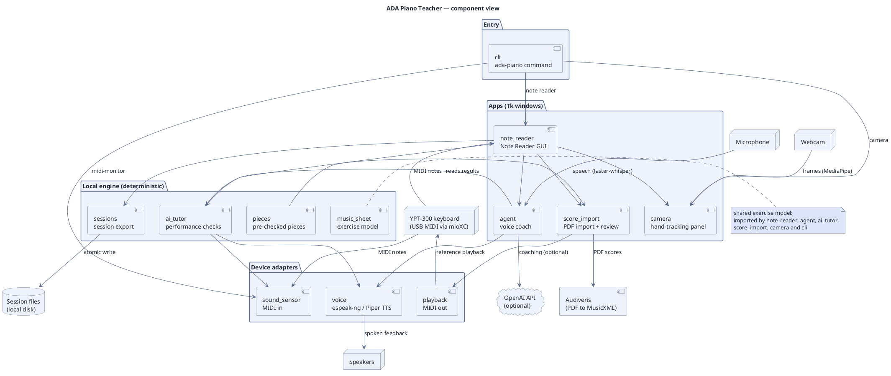

# ADA Piano Teacher — architecture

Every check runs locally and gives the same answer every time. The keyboard, camera and tutor work
offline. The OpenAI coach is an optional layer that explains results the local engine has already
produced. It never decides whether a note was right.



**How to read it:** arrows run from the importer to the thing it uses. This view leaves out
`music_sheet` imports (see the note) and a few back-references (`voice` → `agent`,
`playback` → `score_import`, `score_import` → `agent`) to keep the layout readable.

**Viewing:** open this file in the [docu.md Markdown Viewer](https://docu.md). GitHub shows the
source only. Use [`architecture.png`](architecture.png) there instead.

Regenerate the PNG after editing the diagram:

```bash
npx @markdown-viewer/documd docs/architecture.md --assets /tmp/figs --chrome /usr/bin/chromium
cp /tmp/figs/architecture-01-plantuml.png docs/architecture.png
```
